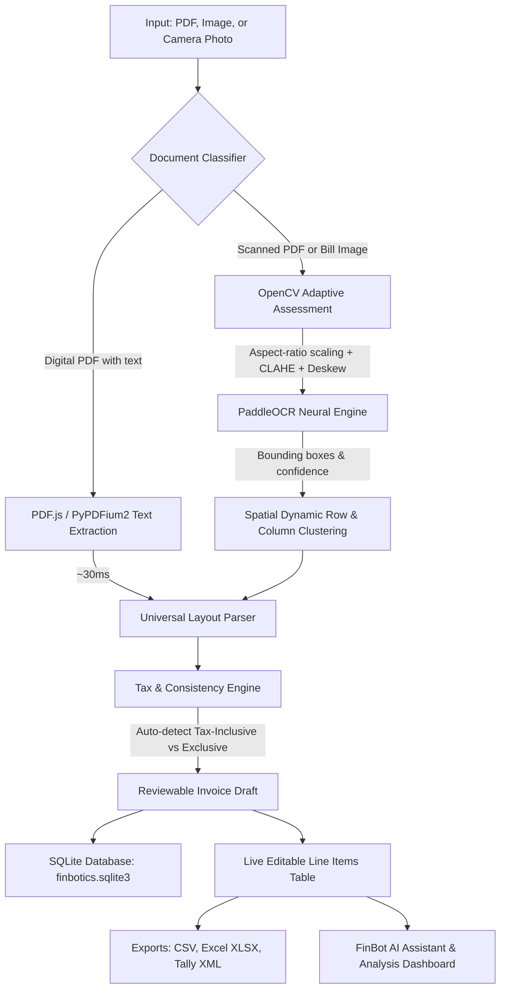

# FinBotics — Universal Invoice Intelligence Suite

FinBotics is a high-speed, local document intelligence application for processing retail receipts, grocery bills, and B2B tax invoices. It seamlessly accepts digital PDFs, scanned PDFs, and camera bill images, extracts line-item records using spatial column projection and adaptive layout parsing, validates tax consistency, stores invoices locally in SQLite, and exports accounting-ready vouchers (CSV, Excel XLSX, and Tally XML).

---

## Architecture Overview



---

## Key Architectural Enhancements & Fixes

### 1. Speed Optimizations
- **Eliminated Bottlenecks:** Removed `cv2.fastNlMeansDenoising` (which was taking 20–30 seconds per image on CPU) and removed `cv2.adaptiveThreshold` (which was corrupting character gradients and degrading PaddleOCR accuracy).
- **Aspect-Ratio Resizing:** Images above 1800px max dimension are scaled down using `INTER_AREA`, speeding up neural inference by ~60% with zero loss of character sharpness.
- **Singleton OCR Engine:** PaddleOCR is initialized as a thread-safe singleton, pre-warmed so model weights are loaded only once in memory.
- **Dual-Speed Pipeline:**
  - **Digital PDFs:** Processed instantaneously (30–50 ms) via embedded PDF text streams.
  - **Scanned Images & Photos:** Processed via optimized PaddleOCR (4–8 seconds).

### 2. Universal Spatial Column & Multi-Strategy Parser
- **Dynamic Y-Clustering:** Replaced the fragile hardcoded `18px` row threshold with dynamic row clustering based on median bounding box height (`y_tol = median_h * 0.70`). Works reliably at 300 DPI, 72 DPI, and high-res camera captures.
- **Spatial Column Grid Projection:** Identifies table headers (`Item Name`, `Qty`, `UOM`, `HSN`, `MRP`, `Rate`, `GST%`, `Taxable`, `Amount`) and assigns tokens based on horizontal column coordinate alignment.
  - Automatically handles **missing cells** (e.g., missing Qty defaults safely, missing MRP preserved, missing GST flagged).
  - Flags **Rate > MRP** pricing anomalies (`rate_above_mrp`).
  - Supports **UOM and HSN/SAC columns** (e.g., Basmati Rice 2 kg HSN 1006).
- **Fallback Tabular & POS Engines:**
  - 6-column, 5-column, 4-column, and 3-column retail formats.
  - POS thermal two-line items (item name on line 1, `Qty x Rate Amount` on line 2).
  - Simple 2-column bills (restaurants, cafes, utilities, cab receipts).
- **Accurate Vendor Identification:**
  - Strips invoice banners (`- TAX INVOICE`, `CASH MEMO`, `BILL OF SUPPLY`).
  - Distinguishes vendors from buyer/customer lines (`Customer:`, `Bill To:`, `Buyer:`).
  - Built-in recognition for 30+ major retail, grocery, and dining brands.

### 3. Unified Frontend Experience
- **Any Document, One Scanner:** Users can drag-and-drop or select any PDF, JPG, PNG, WEBP, or capture directly with a camera.
- **Live Editable Table:** Full inline editing for Item Name, Quantity, MRP, Rate, GST %, and Total Amount.
- **Real-Time Recalculation:** Editing any number immediately recomputes Taxable Value, CGST, SGST, IGST, Slab Totals, and Grand Total.
- **Complete Persistence:** Fully synced with SQLite database (`finbotics.sqlite3`). Saved invoices persist across sessions and power the Dashboard, Invoices list, Reconcile tab, and GST Analysis.

---

## Running the Application

### 1. Start the FastAPI Server

From the project root:

```bash
backend/.venv/bin/python -m uvicorn backend.main:app --reload --host 127.0.0.1 --port 8010
```

### 2. Open the Web Application

Navigate in your browser to:

```text
http://127.0.0.1:8010/
```

Confirm health and status:

```text
http://127.0.0.1:8010/api/status
```

---

## API Reference

| Method | Endpoint | Description |
| --- | --- | --- |
| `GET` | `/` | Serves the unified web interface (`index.html`). |
| `GET` | `/health` | Service health status. |
| `GET` | `/api/status` | Diagnostic endpoint returning OCR engine, parser version, and storage details. |
| `POST` | `/api/ocr` | Accepts image files; runs quality check, neural preprocessing, PaddleOCR, and spatial parser. |
| `POST` | `/api/process-bill` | Unified ingestion endpoint for digital PDFs, scanned PDFs, or images. |
| `POST` | `/api/parse-text` | Parses raw selectable text using the universal layout-aware parser. |
| `GET` | `/api/invoices` | Retrieves all saved invoices from local SQLite database. |
| `PUT` | `/api/invoices/{id}` | Inserts or updates an invoice record in SQLite. |
| `DELETE` | `/api/invoices/{id}` | Deletes a single invoice record. |
| `DELETE` | `/api/invoices` | Clears all saved invoice records. |

---

## Export Capabilities

- **CSV:** Formatted item-by-item breakdown including Store, Bill No, Date, GSTIN, Qty, MRP, Rate, GST%, Taxable, CGST, SGST, Total, and Ledger.
- **Excel (.xlsx):** Multi-tab workbook via SheetJS with Line Items, GST Summary Slabs, and Invoice Metadata.
- **Tally XML:** Accounting voucher format ready for direct import into TallyPrime (`Gateway of Tally → Import → Vouchers`).
