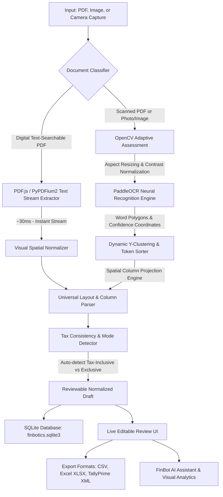

# FinBotics — Comprehensive Architectural & Technical Documentation

**FinBotics** is a high-speed, local document intelligence and financial bookkeeping platform engineered for Indian retail receipts, supermarket bills, and formal B2B GST tax invoices. It bridges digital and physical accounting documents into structured, verified, and export-ready business data.

---

## 1. System Architecture & Processing Workflows

FinBotics utilizes an adaptive dual-pipeline architecture designed to achieve maximum speed on text-searchable digital documents while providing deep neural OCR reconstruction on camera captures and scanned pages.



---

## 2. Dual Pipeline Ingestion Strategy

| Processing Path | Applicable Formats | Typical Latency | Engine & Components |
| :--- | :--- | :--- | :--- |
| **OCR Cache Hit** | Previously processed images / scanned PDFs | **2 – 4 ms** | SHA-256 deterministic byte-hash SQLite cache (`ocr_cache`); instant zero-cost retrieval |
| **Instant Digital Pipeline** | Downloaded digital PDFs (BigBasket, Blinkit, Zepto, D-Mart, Amazon, Uber, Tally PDFs) | **15 – 35 ms** | Client-side PDF.js vector text + bounding-box coordinate extraction / Backend PyPDFium2 stream extraction; bypasses heavy neural networks |
| **Neural OCR Pipeline** | Scanned bills, thermal receipts, mobile photos, flattened scanned PDFs (first pass) | **4 – 11 seconds** (CPU) | OpenCV adaptive quality check + Aspect scaling (1400px clamp) + PaddleOCR v3 (PP-OCRv6_medium) |

---

## 3. High-Speed Neural Preprocessing & OCR Engine

Earlier prototypes suffered from 20–30 second latency and degraded recognition due to improper preprocessing. FinBotics 2.0 re-engineers this pipeline:

1. **Aspect-Ratio Resizing**:
   - Camera uploads (e.g. 12–48 MP mobile photos) are scaled with `cv2.INTER_AREA` so the maximum dimension does not exceed 1800 px.
   - Text strokes remain sharp while bounding box detection runs in a fraction of the time.
2. **Preservation of Natural Gradients**:
   - `cv2.fastNlMeansDenoising` and `cv2.adaptiveThreshold` are **completely eliminated**.
   - Neural OCR networks are trained on continuous gradients; binarization destroys anti-aliasing and introduces thresholding noise.
   - CLAHE (Contrast Limited Adaptive Histogram Equalization) is applied selectively in the Lab color space only when brightness or contrast metrics are severely degraded.
3. **Singleton Pattern**:
   - `PaddleOCREngine` runs as an in-memory singleton. Model weights are cached in RAM upon startup rather than re-instantiated per request.
   - `use_textline_orientation` is bypassed for standard upright documents to prevent redundant classification passes across dozens of text boxes.

---

## 4. Universal Layout & Spatial Column Projection Algorithm

Different invoice types vary fundamentally in structure:
- **Formal B2B / Tax Invoices**: Multicolumn tables (`Sl No`, `Description of Goods`, `HSN/SAC`, `Quantity`, `Rate`, `per`, `Disc %`, `Amount`).
- **Supermarket / Kirana Receipts**: Horizontal sequential records (`Tata Salt 1kg 2 24.00 22.00 0% 44.00`).
- **POS Thermal Slips**: Multi-line pairings (line 1: description; line 2: quantity × rate and total).
- **Hospitality / Simple Slips**: Key-value pairings (`Cappuccino Double ... 220.00`).

### Spatial Column Projection Steps:

1. **Median-Height Dynamic Y-Clustering**:
   Instead of fixed pixel thresholds (which fail across differing DPIs), FinBotics calculates the median bounding-box height $H_{\text{median}}$ of detected tokens. Tokens are clustered into visual lines using a dynamic vertical tolerance:
   $$\Delta Y \le H_{\text{median}} \times 0.70$$
2. **Table Header Localization**:
   The engine scans rows for header anchors (`Item Name`, `Description`, `Particulars`, `HSN/SAC`, `Quantity`, `Rate`, `Taxable`, `Amount`, `GST%`). Each detected column's horizontal span $[X_{\min}, X_{\max}]$ and centroid $X_{\text{center}}$ are indexed.
3. **Serial Number vs. Quantity Isolation**:
   When a row contains an `Sl No` or starts with a leading index (e.g. `1 12MM**`), the index is recognized as a row counter and stripped, preventing it from corrupting the `Quantity` field.
4. **Horizontal Projection with Missing Cell Preservation**:
   Tokens in subsequent item rows are projected horizontally to their nearest header column centroid. When an optional field is missing (e.g. missing MRP or missing explicit GST), the field remains `None` without shifting adjacent numbers.
5. **Hard Boundary Termination**:
   The parser terminates item extraction immediately upon encountering summary anchors:
   `Total`, `Subtotal`, `Amount Chargeable`, `Taxable Value`, `Declaration`, `We declare that`, `Authorised Signatory`.
   This prevents footer notes and secondary tax summary tables from being extracted as phantom line items.

---

## 5. Indian GST Tax & Financial Consistency Engine

### 1. Dual Tax-Mode Auto-Detection
- **Tax-Inclusive Mode (Retail & Grocery)**:
  - Total = $\text{Qty} \times \text{Rate}$
  - Taxable Value = $\frac{\text{Total}}{1 + \frac{\text{GST}\%}{100}}$
  - GST Amount = $\text{Total} - \text{Taxable Value}$
- **Tax-Exclusive Mode (B2B & Tax Invoices)**:
  - Taxable Value = $\text{Qty} \times \text{Rate}$
  - GST Amount = $\text{Taxable Value} \times \frac{\text{GST}\%}{100}$
  - Total Amount = $\text{Taxable Value} + \text{GST Amount}$

The engine inspects column presence and checks whether $(\text{Taxable} + \text{Tax} \approx \text{Total})$. It selects the correct tax mode dynamically, eliminating false reconciliation warnings.

### 2. Tax Splitting & Slabs
- **Intra-State**: Split equally into $\text{CGST} = \frac{\text{GST Amount}}{2}$ and $\text{SGST} = \frac{\text{GST Amount}}{2}$.
- **Inter-State**: Mapped to $\text{IGST} = \text{GST Amount}$.
- Grouped into standard Indian GST Slabs: **0%, 3%, 5%, 12%, 18%, 28%**.

### 3. Financial Anomaly Validation
- **Rate > MRP (`rate_above_mrp`)**: Triggered when unit rate exceeds maximum retail price.
- **Printed Total Mismatch (`total_mismatch`)**: Triggered when the printed grand total differs from the sum of line items by more than ₹1.00.
- **Missing GSTIN (`no_gstin`)**: Flags invoices where no seller GSTIN is present, warning that Input Tax Credit (ITC) cannot be claimed.

---

## 6. Data Model & Storage Schema

Invoices are stored in the local SQLite database (`finbotics.sqlite3`):

```sql
-- Invoices Storage
CREATE TABLE IF NOT EXISTS invoices (
    id TEXT PRIMARY KEY,
    data TEXT NOT NULL,
    updated_at TEXT DEFAULT CURRENT_TIMESTAMP
);

-- Fast Deterministic Content-Hash OCR Cache
CREATE TABLE IF NOT EXISTS ocr_cache (
    hash TEXT PRIMARY KEY,
    response TEXT NOT NULL,
    created_at TEXT DEFAULT CURRENT_TIMESTAMP
);
```

### JSON Record Structure:

```json
{
  "id": 1730221200000,
  "source": "paddle_ocr",
  "store": "Surabhi Hardwares, Bangalore",
  "billNo": "SHB/456/20",
  "date": "20-Dec-20",
  "gstin": "29AACCT3705E000",
  "items": [
    {
      "name": "12MM**",
      "qty": 7.0,
      "uom": "No",
      "hsn": "1005",
      "mrp": 500.0,
      "rate": 500.0,
      "gst": 18,
      "taxable": 3500.0,
      "cgst": 315.0,
      "sgst": 315.0,
      "igst": 0.0,
      "gstAmt": 630.0,
      "taxType": "CGST_SGST",
      "total": 4130.0
    }
  ],
  "slabs": {
    "18": {
      "taxable": 3500.0,
      "gstAmt": 630.0,
      "total": 4130.0
    }
  },
  "computedItemTotal": 4130.0,
  "printedTotal": 4130.0,
  "grandTotal": 4130.0,
  "totalGSTAmt": 630.0,
  "printedGST": 630.0,
  "flags": [],
  "reviewRequired": false
}
```

---

## 7. Export Specifications

1. **CSV**:
   Comprehensive line-item table containing `Store`, `Bill No`, `Date`, `GSTIN`, `Item`, `Qty`, `MRP`, `Rate`, `GST%`, `Taxable`, `CGST`, `SGST`, `Total`, and `Ledger`.
2. **Excel (.xlsx via SheetJS)**:
   Three structured worksheets:
   - *Line Items*: Detailed itemized quantities, rates, and category assignments.
   - *GST Summary*: Input tax credit breakdown per GST slab.
   - *Invoice Info*: Supplier metadata, invoice reference, and totals.
3. **Tally XML**:
   Valid TallyPrime voucher schema (`Purchase` voucher with Party Ledger, Item Expense Ledgers, CGST/SGST/IGST tax ledgers, and Round-Off adjustments). Import path:
   `TallyPrime → Gateway of Tally → Import → Vouchers → Select XML → Accept`.

---

## 8. REST API Reference

| Endpoint | Method | Payload / Form | Output | Description |
| :--- | :--- | :--- | :--- | :--- |
| `/` | `GET` | None | HTML | Serves the web UI |
| `/health` | `GET` | None | JSON | Health status & version check |
| `/api/status` | `GET` | None | JSON | Diagnostic status of OCR, parser & storage |
| `/api/process-bill` | `POST` | `multipart/form-data` (`file`) | JSON | Unified route for digital PDFs, scanned PDFs & images |
| `/api/ocr` | `POST` | `multipart/form-data` (`file`) | JSON | Image OCR route with quality & validation breakdown |
| `/api/parse-text` | `POST` | `{"text": "..."}` | JSON | Direct layout parsing on extracted text |
| `/api/invoices` | `GET` | None | JSON | Retrieves all stored invoices |
| `/api/invoices/{id}` | `PUT` | JSON Invoice Object | JSON | Inserts or updates an invoice |
| `/api/invoices/{id}` | `DELETE` | None | JSON | Deletes an invoice |
| `/api/invoices` | `DELETE` | None | JSON | Clears the database |
